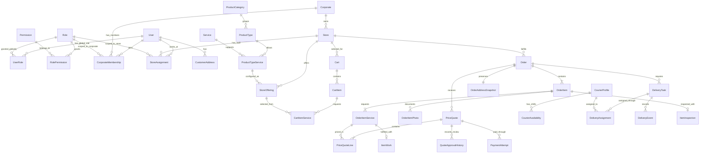

# GiysiGO veritabanı taslağı

Bu taslak, dört kişilik ekibin Identity, Catalog, Ordering ve Operations modülleri için hazırlanmıştır. Müşterinin verdiği ilk kategori/fiyat listesi `catalog-draft.json` içinde yapılandırılmıştır. Belirsiz fiyat ve seçim kuralları netleşince seed kayıtları kesinleştirilecektir. Düzenlenebilir MSSQL modeli `database/GiysiGo.Database` içindedir. API iskeleti hazırdır; modül iş akışları henüz uygulanmamıştır.

Her tablonun amacı, hangi aşamada yazılıp okunduğu ve benzer tablolardan farkı için [39 tabloyu tek tek açıklayan rehbere](TABLE-PURPOSES.md) bakın.

## Kabul edilen iş kuralları

- Corporate hizmet veren şirketi, Store bu şirkete bağlı fiziksel dükkânı temsil eder.
- Hizmet, kategori ve ürün tiplerini platform yönetir. Dükkân yeni hizmet oluşturamaz; izin verilen ürün tipi ve hizmet kombinasyonlarını etkinleştirir.
- Platform varsayılan fiyat tanımlar; her dükkân kendi fiyatını belirleyebilir.
- Adresin dükkâna kilometre uzaklığı, dükkânın hizmet yarıçapı içinde olmalıdır. MVP için bu uzaklık kuş uçuşu olarak önerilmiştir; yol mesafesi ayrıca kararlaştırılabilir.
- Her sepet ve sipariş yalnızca bir dükkâna aittir.
- Her fiziksel ürün ayrı kayıttır; aynı tipte iki gömlek iki ayrı sipariş kalemidir.
- İlk fiyat tahminidir. Dükkân bütün ürünleri inceler, kesin teklif gönderir. Müşteri teklifin tamamını kabul eder veya reddeder.
- Ret halinde siparişin tamamı müşteriye geri gönderilir. İade taşıma ücretinin kime ait olacağı henüz kararlaştırılmamıştır.
- Hizmet işlemleri ancak kabul edilen teklifin ödemesi doğrulanınca başlar.
- Tek User tablosu müşteri, şirket yöneticisi ve dükkân personelini kapsar. Aynı kişi birden fazla şirkette veya dükkânda görev alabilir.
- MVP'de müşteri ve dükkân yönetim panelleri vardır. Kurye paneli yoktur; mock kurye kayıtları üzerinde gerçek otomatik atama kuralı çalıştırılır. Kurye hareketleri test/demonstrasyon komutlarıyla ilerletilir.

## Dört modül ve tablo sahipliği

Tek uygulama ve tek MSSQL veritabanı önerilir. Modüller kendi şemalarındaki SQL proje dosyalarını yönetir. Dört modül dört tablo anlamına gelmez.

| Modül | Sorumluluk | Tablolar |
| --- | --- | --- |
| Identity | Kullanıcı, şirket, personel, yetki ve adres | User, Role, Permission, RolePermission, UserRole, Corporate, CorporateMembership, StoreAssignment, CustomerAddress |
| Catalog | Dükkân, hizmet bölgesi, katalog ve fiyat tarifesi | Store, ProductCategory, ProductType, Service, ProductTypeService, StoreOffering |
| Ordering | Sepet, sipariş, teklif, onay ve ödeme kayıtları | Cart, CartItem, CartItemService, CartItemPhoto, Order, OrderAddressSnapshot, OrderItem, OrderItemService, OrderItemPhoto, PriceQuote, PriceQuoteLine, QuoteApprovalHistory, PaymentAttempt, OrderStatusHistory |
| Operations | Ürün kabulü, fotoğraflı inceleme, işlem ve mock kuryelerle otomatik atama | CourierProfile, CourierAvailability, DeliveryTask, DeliveryAssignment, DeliveryEvent, ItemInspection, InspectionPhoto, ItemWork, ItemWorkHistory |

CorporateMembership kullanıcıya şirkette rol verir; StoreAssignment kullanıcıya belirli dükkânda rol verir. Müşteri User üzerinden tanınabilir; müşteriye özel alanlar gerektiğinde CustomerProfile eklenebilir. Bir kullanıcı hem müşteri hem personel olabilir.

## Kullanıcı, rol ve yetki modeli

| Tablo | Önemli alanlar ve kurallar |
| --- | --- |
| User | Id, Email, PasswordHash, IsActive, CreatedAt; e-posta benzersiz |
| Role | Id, Code, Name, Scope, IsActive; Scope = Global, Corporate veya Store; Code benzersiz |
| Permission | Id, Code, Description, IsActive; Code benzersiz, uygulama tarafından tanımlanır |
| RolePermission | RoleId, PermissionId; birleşik anahtar, tekrarlı atama olamaz |
| UserRole | UserId, RoleId; yalnızca Global kapsamlı roller atanır |
| CorporateMembership | UserId, CorporateId, RoleId, IsActive; yalnızca Corporate kapsamlı roller atanır |
| StoreAssignment | UserId, StoreId, RoleId, IsActive; yalnızca Store kapsamlı roller atanır |

Role kapsamı ile atandığı yer eşleşmelidir; bu kural uygulamada ve mümkünse veritabanında doğrulanır. Aynı kişi bir dükkânda yönetici, başka dükkânda çalışan olabilir. RolePermission rolün *ne yapabileceğini*, Membership/Assignment ise *hangi şirket veya dükkânda yapabileceğini* belirler. Yetki denetimi her işlemde bu ikisini birlikte kontrol eder; istemcinin gönderdiği StoreId tek başına güvenilir değildir. Şirket rolü, kendi şirketine bağlı dükkânlarda yetki verir; dükkân rolü başka şubeye taşınmaz.

Başlangıç rol örnekleri: Customer (Global), PlatformAdmin (Global), CorporateOwner (Corporate), StoreManager (Store), StoreStaff (Store). Müşteri kendi kayıtları için ayrıca sahiplik kontrolüne tabidir. Rol/permission tabloları seed ile doldurulur; dükkân yöneticisi kendine yeni permission tanımlayamaz.

| Permission kodu | Örnek yetki |
| --- | --- |
| `store.view` | Yetkili olduğu dükkânı görme |
| `store.staff.manage` | Dükkân personeli atama/kaldırma |
| `store.offering.manage` | Önceden tanımlı hizmetleri açma ve dükkân fiyatı belirleme |
| `order.view` | Dükkâna ait siparişleri görme |
| `order.inspect` | Ürün incelemesini kaydetme |
| `quote.prepare` | Kesin teklif taslağı hazırlama |
| `quote.approve` | Teklifi dükkân adına onaylama ve müşteriye gönderme |
| `order.process` | Ödemesi doğrulanmış ürünün işlemini yürütme |
| `order.fulfill` | Hazır ürünün teslimat geçişini yönetme |

Örnek eşleme: StoreStaff `order.view`, `order.inspect`, `quote.prepare`, `order.process` alabilir. StoreManager bunlara ek olarak `quote.approve`, `store.offering.manage`, `order.fulfill` ve `store.staff.manage` alır. CorporateOwner kendi şirketindeki dükkânlar için yönetim yetkilerine sahiptir. Bu eşleme başlangıç seed önerisidir; yetki kodları API'de sabit kalırken rol eşlemesi değişebilir.

`store.staff.manage` yalnızca izin verilen alt rolleri atayabilir; kişinin kendine, başka şirkete veya kendi rolünden daha yüksek bir role yetki vermesi engellenir. İlk CorporateOwner ataması platform yöneticisi tarafından yapılır. `PlatformAdmin` dışında kimse platform katalog kayıtları veya permission tanımları oluşturamaz.

Kullanıcı paneli ve dükkân paneli aynı kimlik altyapısını kullanır. Dükkan panelinde oturum açan kişi önce yetkili olduğu şirket/dükkânı seçer; API her istekte kapsamı yeniden doğrular. Panelde bir düğmenin gizlenmesi güvenlik kontrolü yerine geçmez.

## Temel ilişkiler

Modüller arası çağrılar public contract ve integration event üzerinden yapılır; başka modülün entity veya repository'si kullanılmaz. SQL şemasında hem modül içi hem modüller arası ilişkiler foreign key ile korunur; DACPAC yayınlama işlemi nesneleri bağımlılık sırasıyla oluşturur.

## Katalog ve fiyat alanları

| Tablo | Önemli alanlar ve kurallar |
| --- | --- |
| Corporate | Id, Name, IsActive |
| Store | Id, CorporateId, Name, AddressText, Latitude, Longitude, ServiceRadiusKm, IsActive |
| ProductCategory | Id, Code, Name, IsActive |
| ProductType | Id, CategoryId, Code, Name, IsActive |
| Service | Id, Code, Name, IsActive |
| ProductTypeService | Id, ProductTypeId, ServiceId, DefaultPrice, Currency, PriceUnit, SelectionKind, IsDefaultSelected, IsActive; ürün tipi ve hizmet çifti benzersiz |
| StoreOffering | Id, StoreId, ProductTypeServiceId, PriceOverride, IsActive; dükkân ve kombinasyon çifti benzersiz |

Örnek: Pantolon + paça kısaltma geçerli bir ProductTypeService kaydıdır. Aynı hizmet gömlek için geçerli değilse o kombinasyon bulunmaz. Dükkânın etkin StoreOffering kaydı yoksa müşteri o dükkânda bu kombinasyonu seçemez.

Tahmini hizmet fiyatı: `PriceOverride ?? DefaultPrice`. Varsayılan fiyat ürün tipi ve hizmet kombinasyonuna aittir; tek bir hizmetin bütün ürünlerde aynı fiyat olduğu varsayılmaz. Dükkân kendi fiyatını girmeden varsayılanı kullanıyorsa, platform varsayılanı değiştiğinde yeni sepet hesapları yeni fiyatı kullanır. Mevcut siparişlerin fiyatı değişmez.

### Müşterinin gönderdiği katalog

Gönderilen listeden 5 ürün kategorisi, 48 ürün tipi, 159 ürün-hizmet fiyatı ve tekrar eden adlar birleştirilince 121 farklı hizmet etiketi çıkarıldı. Ek olarak “Sadece Terzi & Tadilat” girişinde 16 fiyatlı işlem var. Bu son bölüm fiziksel ürün kategorisi gibi değerlendirilmez: müşteri terzi ekranından girdiğinde yine ürün tipini seçer ve ürün için geçerli tadilat hizmetleri gösterilir. Aynı işlemi ayrı ürün/hizmet kopyalarıyla iki kez fiyatlandırmak geçmiş ve filtreleme sorunları yaratır. Bu 16 işlem mevcut kombinasyonlara tek tek eşleştirildikten sonra seed edilir.

Yapılandırılmış liste `docs/catalog-draft.json`, onu tekrar üreten ayrıştırıcı `docs/import-catalog.mjs` dosyasındadır. JSON'da `BASE` işaretli bir adet `[x]` satırı, ayrıca `ALTERNATIVE` ve `ADD_ON` satırları bulunur. `+` işareti ek hizmet fiyatını belirtir; fiyat her zaman katalogdaki ürün-hizmet kombinasyonuna bağlıdır. İçe aktarılan adlar kullanıcının yazdığı şekliyle korunmuştur; birbirine benzeyen hizmetleri otomatik olarak birleştirmek doğru olmaz.

Seçim ekranında aynı ürünün “kuru temizleme & ütü” ve “sadece ütü” gibi ana seçeneklerinden en fazla biri seçilir; ek tadilatlar bunlara eklenebilir. Yalnız terzi akışında ana temizlik hizmeti gerekmez. `[x]` işaretinin kaldırılabilir varsayılan seçim mi yoksa zorunlu hizmet mi olduğu henüz netleşmediğinden `IsDefaultSelected` yalnızca başlangıç durumunu temsil eder; zorunluluk kuralı eklenmedi.

Perde ana hizmetleri metrekare fiyatlıdır. Metrekare tutarı `birim fiyat × ölçülen m²` olarak hesaplanır ve siparişte müşteri ölçüsü ile dükkânın doğruladığı ölçü ayrı saklanmalıdır. Perde tadilatlarının `+120 TL` gibi ek fiyatlarının adet başına mı metre başına mı olduğu listede belirtilmediği için JSON'da `priceUnit: null` bırakıldı. Bu satırlar birim netleşmeden satın alınabilir teklif olarak yayımlanmaz.

Listede fiyat kontrolü gerektiren başka noktalar da var: taşlı/güpürlü yatak örtüsü için zaten ayrı ürün tipi tanımlanmışken aynı ürüne “hassas işlem farkı” eklenmiş; yastıkta “elyaf/tüy” ürününde “yün/kaz tüyü özel yıkama” alternatif olarak yer alıyor; “büyük boy battaniye” ayrı ürün tipiyken ayrıca büyük boy farkı var. Bunlar kaynak listedeki değerleriyle korundu, fakat çift ücret veya yanlış ürün-hizmet seçimine yol açmamak için aktif katalogya alınmadan önce doğrulanmalıdır.

Hizmet ve ürün katalogları enum olmaz. Sabit durumlar için enum kullanılabilir: OrderStatus, DeliveryTaskType, PaymentStatus, QuoteStatus. Enum sayısal değerleri sonradan yeniden numaralandırılmamalıdır.

## Adrese göre dükkân listeleme

1. Müşteriye ait seçili adresin enlem ve boylamı alınır.
2. Etkin şirketlerin etkin dükkânları değerlendirilir.
3. Mesafesi `ServiceRadiusKm` sınırını aşmayan dükkânlar seçilir.
4. Hizmet filtresi, etkin StoreOffering ve etkin katalog kayıtları üzerinden uygulanır.
5. Birden fazla hizmet seçilirse varsayılan davranış hepsini sunan dükkânları göstermektir. Ürün tipi biliniyorsa filtre geçerli ürün tipi ve hizmet kombinasyonları üzerinden çalışır.
6. Mesafe sırasıyla sonuçlar döndürülür.

MSSQL için dükkân yarıçapı sorgusu ilk sürümde aday dükkânlar üzerinde Haversine hesabıyla doğrulanır. Veri büyüdüğünde SQL Server `geography` ve spatial index kullanılabilir; metre/kilometre birimleri ve koordinat sırası entegrasyon testinde doğrulanmalıdır.

Sipariş oluşturulurken adres, dükkânın etkinliği, hizmet bölgesi ve bütün seçili kombinasyonlar tekrar doğrulanır. Sepete ekleme anındaki kontrol tek başına yeterli değildir.

## Sepet ve sipariş

- Cart: CustomerId, StoreId, AddressId, PickupWindowStart, PickupWindowEnd, Status, Version. Alım aralığı başlangıcı bitişten önce olmalıdır.
- CartItem: CartId, ProductTypeId, CustomerNote, CustomerMeasurement; her kayıt bir fiziksel ürün. Ölçülü ürünlerde müşteri ölçüsü tahmini tutar içindir.
- CartItemService: CartItemId, StoreOfferingId; aynı ürüne aynı kombinasyon tekrar eklenemez.
- CartItemPhoto: CartItemId, StorageKey, PhotoType, CreatedAt. Fotoğrafın kendisi dosya depolamada tutulur.
- Order: CustomerId, StoreId, PickupWindowStart, PickupWindowEnd, Status, EstimatedTotal, Currency, Version, CreatedAt. Seçilen alım aralığı siparişe kopyalanır.
- OrderAddressSnapshot: OrderId benzersiz; sipariş anındaki adres metni, koordinatlar ve teslimat iletişim bilgileri. Sonradan adres düzenlenmesi siparişi etkilemez.
- OrderItem: OrderId, ProductTypeId, ProductTypeNameSnapshot, CustomerNote, CustomerMeasurement, VerifiedMeasurement, TrackingCode, InspectionStatus. TrackingCode benzersizdir; doğrulanmış ölçü kesin teklifte kullanılır.
- OrderItemService: OrderItemId, ProductTypeServiceId, ServiceNameSnapshot, EstimatedUnitPrice, PriceUnitSnapshot, EstimatedQuantity, EstimatedPrice, Status. Tahmini tutarın nasıl hesaplandığı korunur.
- OrderItemPhoto: OrderItemId, StorageKey, PhotoType, CreatedAt. Sipariş sonrası değişmeyen fotoğraf referansı.

Sipariş oluşturulurken sepet kalemleri, hizmetler, fotoğraf referansları, adres ve tahmini fiyatlar siparişe aktarılır. Fotoğraflar sipariş oluşunca müşterinin sepet düzenlemesiyle değiştirilemez; sipariş fotoğraf referansları ayrıca kalıcılaştırılır. Bir sepet en fazla bir sipariş oluşturur. Checkout isteği tekrarlandığında ikinci sipariş oluşmaması için benzersiz kaynak sepet kimliği ve idempotency anahtarı kullanılır.

Dükkân değiştirilirken mevcut sepet sessizce başka dükkâna taşınmaz; müşteriye yeni sepet açılması veya mevcut sepetin temizlenmesi seçeneği sunulur.

## İnceleme ve kesin teklif

- ItemInspection her ürün için kabul/red sonucunu, personeli, açıklamayı ve kontrol zamanını saklar.
- InspectionPhoto incelemedeki ürün durumunu belgeler.
- PriceQuote: OrderId, Revision, Status, Currency, TotalAmount, CreatedAt, ExpiresAt, CustomerDecisionAt, DecisionByUserId.
- PriceQuoteLine: PriceQuoteId, OrderItemServiceId, ServiceNameSnapshot, UnitPrice, PriceUnit, Quantity, Amount, Explanation. Ölçülü hizmetlerde `Amount = UnitPrice × Quantity`; elle belirlenen kesin fiyat varsa gerekçe saklanır.
- QuoteApprovalHistory: PriceQuoteId, Action (Submitted/Approved/Rejected/Published), ActorUserId, Reason, CreatedAt. Dükkân içi onay geçmişi saklanır.
- Toplama ve teslimat ücretleri varsa teklif üzerinde ayrı tutar olarak gösterilir; toplam bunları da kapsar.

Dükkân bütün ürünleri incelemeden teklif taslağını onaya gönderemez. `quote.prepare` sahibi taslağı kaydeder; `quote.approve` sahibi toplamı onaylayıp müşteriye yayımlar. İki yetki aynı kullanıcıda bulunabilir; iki ayrı kişinin onayı istenirse ayrıca görev ayrılığı kuralı eklenir. `quote.approve` yetkisi olmayan personel teklifi yayımlayamaz. MVP'de kabul edilmeyen ürün varsa siparişin tamamının geri dönüşe yönlendirilmesi önerilir; bu istisna kuralı ayrıca kesinleştirilecektir. Teklif, kabul edilen bütün hizmet kalemlerini ve bütün ücretleri içerir.

Onaylanan teklifin kalemleri değiştirilmez; onay ve müşteriye yayımlama aynı atomik işlem olabilir. Düzeltme yeni revizyondur; önceki teklif Superseded olur. Müşteri yalnızca son geçerli, süresi dolmamış teklifi kabul edebilir. Müşterinin kabul/ret kararı dükkân içi onaydan ayrıdır; yalnızca siparişin CustomerId kullanıcısı karar verebilir. Kabul ve ret kararları kullanıcı ve zaman bilgisiyle saklanır. Kabul edilen fiyat değişirse yeni teklif, yeni dükkân onayı ve yeni müşteri onayı gerekir.

## Ödeme ve operasyon akışı

Normal akış:

`AwaitingPickupAssignment → PickupAssigned → PickedUp → AtStore → Inspecting → AwaitingStoreApproval → AwaitingCustomerApproval → AwaitingPayment → Processing → ReadyForDelivery → DeliveryAssigned → OutForDelivery → Delivered`

Teklif reddi:

`AwaitingCustomerApproval → ReturnRequested → ReturnAssigned → ReturnInTransit → Returned`

### Kurye ve teslimat verisi

| Tablo | Önemli alanlar ve kurallar |
| --- | --- |
| CourierProfile | Id, UserId nullable, DisplayName, IsMock, IsActive, VehicleType, CapacityUnits, Latitude, Longitude, MaxTaskRadiusKm; mock kurye için UserId boş olabilir |
| CourierAvailability | Id, CourierId, StartsAt, EndsAt, Status; çalışma/müsaitlik aralığı, başlangıç bitişten önce |
| DeliveryTask | Id, OrderId, Type, Status, OriginAddressSnapshot, OriginLatitude, OriginLongitude, DestinationAddressSnapshot, DestinationLatitude, DestinationLongitude, RequestedWindowStart, RequestedWindowEnd, RequiredCapacityUnits, CreatedAt; Type = CustomerPickup, CustomerDelivery veya RejectedOrderReturn |
| DeliveryAssignment | Id, DeliveryTaskId, CourierId, Status, AssignedAt, UnassignedAt, AssignmentReason, DistanceKm; yeniden atama geçmişi, görev başına en fazla bir etkin atama |
| DeliveryEvent | Id, DeliveryTaskId, EventType, Source, ActorUserId nullable, OccurredAt, Note; mock durum ilerletmeleri de denetlenebilir |

Kurye profili Operations'a aittir. İleride kurye paneli açıldığında gerçek kurye User hesabıyla bağlanır; müşteri ve dükkân panelinin kimlik modeli korunur. Mock profilin User hesabı ve oturum açma yetkisi olmaz. Test verisi gerçek müşteriye atanıp gösterilmemelidir; mock profiller yalnızca geliştirme/test ortamında veya açıkça işaretli demo siparişlerinde kullanılmalıdır.

`CustomerPickup` müşteriden dükkâna, `CustomerDelivery` ve `RejectedOrderReturn` dükkândan müşteriye gider. Görev adresleri OrderAddressSnapshot ve siparişe bağlı dükkânın adresinden kopyalanır. `IsMock = false` olan CourierProfile için UserId zorunludur; mock profilde UserId boş kalır. Aynı sipariş ve görev türü için eşzamanlı tek açık DeliveryTask bulunur; tekrarlanan olaylar yeni görev üretmez.

### Otomatik atama kuralı

1. Sipariş oluşturulunca seçilen alım zaman aralığıyla `CustomerPickup` görevi açılır ve atama denenir. Teklif reddedilirse `RejectedOrderReturn`, ürünler hazır olunca `CustomerDelivery` görevi açılır; bu görevlerin teslimat zaman aralığı ayrıca belirlenir. Aynı seçim kuralı her görev için yeniden çalışır.
2. Etkin, görevin **tam zaman aralığında** müsait, kapasitesi yeterli ve görevin başlangıç noktasına `MaxTaskRadiusKm` içinde olan kuryeler adaydır. Zaman aralığıyla çakışan etkin görevlerin yükü kapasite hesabından düşülür; bugün tamamlanmış veya başka saatteki görevler düşülmez. MVP'de kapasite birimi siparişteki fiziksel ürün adedidir; büyük ev tekstili gibi ürünler gelince bu kural değişebilir.
3. Adaylar başlangıç noktasına uzaklık, etkin görev sayısı ve CourierId sırasıyla seçilir. Son bağlayıcı alan testlerde tutarlı sonuç sağlar. MVP mesafesi kuş uçuşudur.
4. Atama bir transaction içinde yapılır; aynı kuryenin aynı zaman aralığındaki kapasitesi ve görevin etkin ataması eşzamanlı isteklerde yeniden kontrol edilir. Görev başına tek etkin atamayı filtered/partial unique index korur. Kurye kapasitesi toplamı için ayrıca kurye satırı üzerinde kilit veya eşdeğer serileştirme gerekir; yalnızca görev unique index'i kapasite aşımını engellemez.
5. Aday yoksa görev `PendingAssignment` kalır ve dükkân panelinde görünür; müşteri ekranında kurye atanmış denmez. Kurye müsaitliği değiştiğinde veya yetkili kişi yeniden denediğinde atama tekrarlanır.

İlk deneme başarılı olsa bile kurye ataması teslim alma gerçekleşti anlamına gelmez. `PickedUp`, `AtStore`, `OutForDelivery` ve `Delivered` için mock olaylar ayrı komutlarla üretilir; kaynak `Mock` olarak kaydedilir. Alım görevi `AtStore`, dönüş görevi `Returned`, teslim görevi `Delivered` olunca tamamlanır ve ilgili rezervasyon serbest kalır. İptal/yeniden atama da eski rezervasyonu kapatır. Gerçek kurye paneli geldiğinde aynı geçişleri kurye uygulaması üretir. Aynı kurye gidiş ve dönüşe zorunlu atanmaz. Dükkân panelindeki mock geçiş komutları yalnızca yetkili kullanıcıya ve demo/test ortamına açılır; otomatik zamanlayıcı siparişi kendiliğinden teslim edilmiş saymaz.

### Tekrarlanabilir mock veri ve testler

Migration'dan ayrı, yalnızca geliştirme/test ortamında çalışan idempotent seed önerilir. Gerçek kişi bilgisi içermeyen sabit kimlikler kullanılır. Aşağıdaki koordinatlar ve kayıtlar örnek test fikstürüdür; ürün ve dükkân seed'i geldiğinde yakın noktalarla eşleştirilir.

| Kurye | Konum (enlem, boylam) | Yarıçap | Kapasite | Durum | Beklenen kullanım |
| --- | --- | --- | --- | --- | --- |
| MOCK-COURIER-01 | 40.9900, 29.0300 | 8 km | 3 birim | Müsait | Yakın, küçük alım görevleri |
| MOCK-COURIER-02 | 40.9950, 29.0450 | 12 km | 8 birim | Müsait | Büyük sipariş veya ilk kurye doluysa |
| MOCK-COURIER-03 | 41.0200, 29.0800 | 10 km | 5 birim | Meşgul | Müsait değilken seçilmemeli |

Minimum anlamlı testler: en yakın uygun kurye seçilir; yakın kurye kapasitesizse ikinci kurye seçilir; vardiya dışında veya meşgul kurye seçilmez; hiç aday yoksa görev bekler; iki eşzamanlı görev aynı kapasiteyi aşamaz; tekrar gelen atama isteği ikinci etkin atama yaratmaz; müşteri teklifini reddedince dönüş görevi ayrı atanır; teslimat olayı gelmeden sipariş Delivered olmaz. Seed kayıtları ve otomatik testler veritabanı motoru ile backend iskeleti kesinleşince eklenir.

PaymentAttempt: OrderId, PriceQuoteId, Amount, Currency, Provider, ProviderPaymentId, IdempotencyKey, Status, CreatedAt. Her deneme ayrı kayıttır. Tekrarlanan ödeme bildirimi aynı tahsilatı ikinci kez işlemez. İşleme başlama şartı, onaylanan teklif ile tutarı ve para birimi eşleşen doğrulanmış başarılı ödemedir. İstemcideki ödeme başarılı ekranı tek başına yeterli değildir.

ItemWork her ürün hizmetinin işlem durumunu saklar. Sipariş ancak gerekli bütün hizmetler tamamlandığında teslimata hazır olur. OrderStatusHistory ve ItemWorkHistory durum, zaman, işlemi yapan kullanıcı ve açıklamayı kaydeder.

Kart numarası ve CVV tutulmaz. Ödeme sağlayıcısı entegrasyonu Ordering içinde adaptör olarak kalır; beşinci iş modülü gerekmez.

## Veri bütünlüğü ve uygulanacak sınırlar

- Para alanlarında decimal/numeric kullanılır; float kullanılmaz. MVP için tek para birimi TRY önerilir.
- Fiyatlar negatif, hizmet yarıçapı sıfır veya negatif olamaz; koordinatlar geçerli aralıkta olmalıdır.
- Siparişteki bütün ürün hizmetleri siparişin dükkânına ve ürün tipine uygun olmalıdır.
- Müşteri yalnızca kendi adresi, sepeti, siparişi ve teklif kararı üzerinde işlem yapabilir.
- Personel permission'ı yeterli olsa bile şirket/dükkân kapsamı ayrıca doğrulanır. Şirket veya dükkân üyeliği kapatıldığında erişim kesilir.
- Kullanılmış katalog kayıtları silinmez, pasifleştirilir. Sipariş kopyaları geçmişi korur.
- Teklifin dükkân onayı, müşterinin kabulü, ödeme bildirimi ve kurye ataması arasındaki yarışlar transaction, unique constraint ve sürüm kontrolüyle yönetilir.
- Modüller arası önemli olaylar transaction içinde Outbox'a yazılarak kayıp ödeme ve durum olayları önlenir. Outbox altyapı tablosudur, ayrı iş modülü değildir. Tüketiciler tekrarlanan olaylara dayanıklı olmalıdır.

## Liste geldiğinde kesinleştirilecekler

Terzi girişindeki 16 işlem ürün tiplerine eşleştirilecek. `[x]` işaretinin zorunluluk anlamı, perde ek hizmetlerinin fiyat birimi, büyük boy/taşlı ürünlerde olası çift ücretler ve yastık malzemesi doğrulanacak. Zorunlu fotoğraf türleri, ölçü yuvarlama kuralı ve diğer ölçülü ürünler de kesin katalog seed'inden önce belirlenecek.

Veritabanı motoru MSSQL olarak kesinleşmiştir. Ürün tipi hiyerarşisinin derinliği, iade taşıma ücreti, dükkânın ürünü kabul etmemesi ve işlem sonrası başarısız teslimat kuralları açık iş kararlarıdır. Teklif süresi ve iptal için mevcut MVP sınırları [operasyon sözleşmesinde](WORKFLOW-CONTRACTS.md) tanımlıdır; otomatik süre sonu iadesi/ödeme iptali etkin değildir. İlk sürümde müşteri ve dükkân yönetim panelleri geliştirilecek; mock kurye verisiyle otomatik atama test edilecek. Kurye paneli, canlı konum, mesajlaşma, kampanya ve rota optimizasyonu temel akışa eklenmeyecek.
